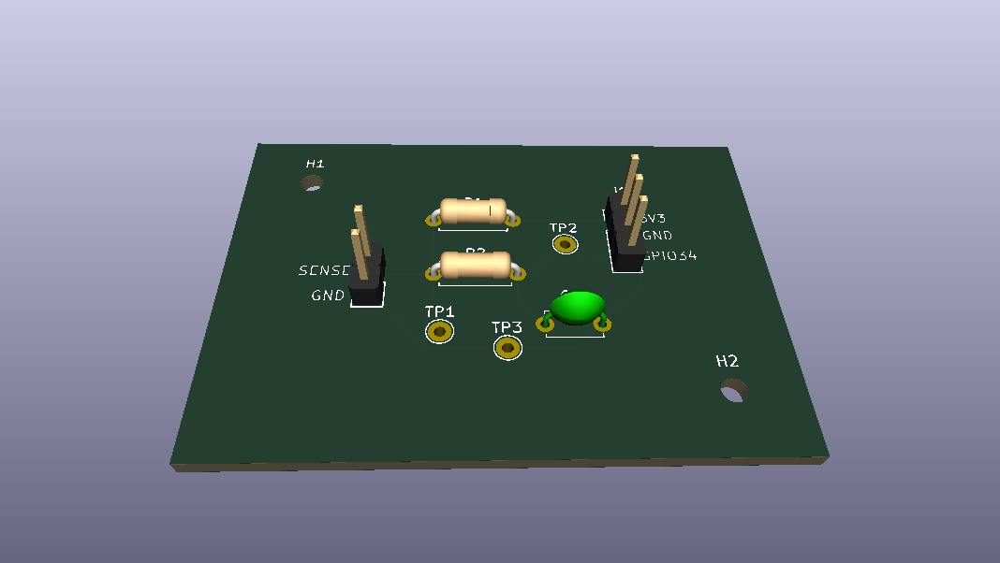
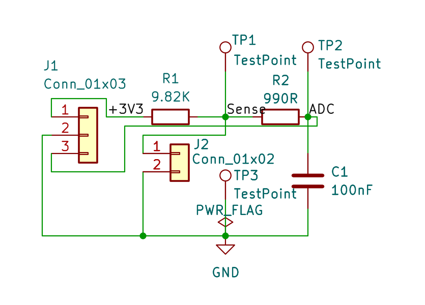
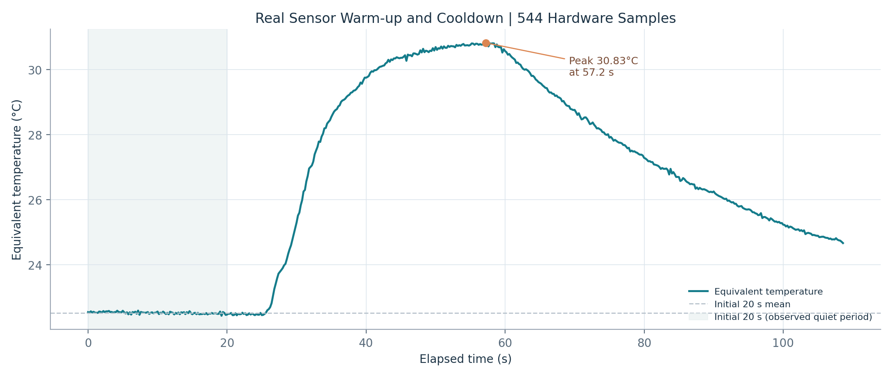
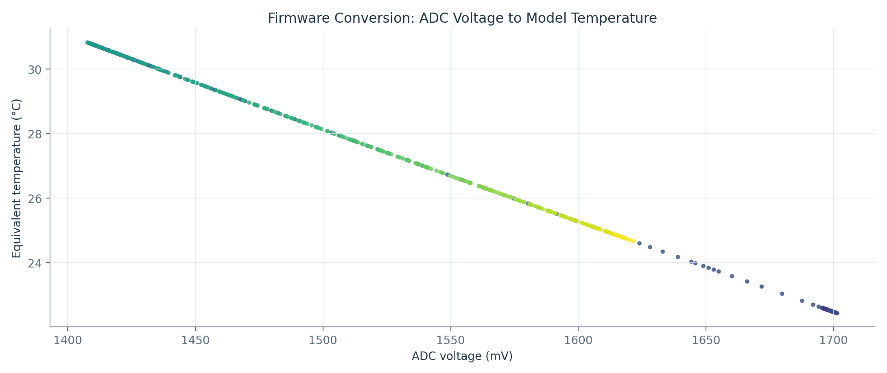

# ThermoBench | ESP32 Temperature Sensing & Hardware Validation

**Embedded systems · Analog circuits · PCB design · Python test automation**

ThermoBench is an electrical engineering portfolio project that combines an ESP32 microcontroller, an NTC thermistor, analog signal conditioning, temperature monitoring, simulated fault scenarios, and analysis of real breadboard measurements. This repository provides the **engineering report, design files, source code, calculations, graphs, and test evidence**.

> **Project status:** Physical breadboard measurements documented · KiCad PCB designed but **not fabricated/tested** · LTspice and Wokwi are separate simulation environments · No claim of calibrated temperature accuracy.

## Quick access — find the files

| What you need | Direct link | What it contains |
|---|---|---|
| **Final engineering report** | [Read the 23-page PDF](01_Report/ThermoBench_Engineering_Design_and_Validation_Report.pdf) | Project design, tests, results, assumptions, and limitations |
| **Project presentation** | [Interview study guide](01_Report/ThermoBench_Interview_Study_Guide.pdf) | Short technical explanation and presentation notes |
| **Circuit schematic** | [View schematic PDF](03_CAD_Visuals/KiCad_Schematic_Original_A4.pdf) / [KiCad source](02_KiCad_Source/ThermoBench_Sensor_Adapter.kicad_sch) | Actual circuit drawing and editable schematic |
| **PCB design** | [KiCad PCB](02_KiCad_Source/ThermoBench_Sensor_Adapter.kicad_pcb) / [3D top view](03_CAD_Visuals/3D_Top_Original.png) | Routed PCB design and visual render |
| **Hardware and PCB walkthrough** | [Component and PCB guide](docs/hardware-pcb-guide.md) | Component functions, wiring, connectors, test points, and PCB design |
| **ESP32 firmware** | [thermobench.ino](04_Firmware_and_Python/thermobench.ino) | Microcontroller source code |
| **Python scripts** | [Source folder](04_Firmware_and_Python/) / [Build instructions](04_Firmware_and_Python/BUILD_STEPS.md) | Data processing, dashboard, reporting, and tests |
| **Firmware & Python walkthrough** | [Code guide](docs/firmware-python-guide.md) | ESP32 firmware, Python dashboard, CSV analysis, unit tests and limitations |
| **Engineering calculations** | [Step-by-step calculations](docs/calculations.md) | NTC model, voltage divider, RC filter, ADC, and testing results |
| **Real measurements** | [Physical CSV files](05_Hardware_CSV/) | Recorded breadboard data — not simulations |
| **Graphs and results** | [Analysis figures](06_Analysis/) / [Temperature response](06_Analysis/thermal_response.png) | Visualizations derived from analysis |
| **Results and validation guide** | [Measurement and graph walkthrough](docs/results-validation-guide.md) | Original hardware data, verified statistics, figures and evidence limitations |
| **LTspice circuit simulation** | [Simulation sources](09_LTspice_Simulation/) / [Simulation guide](09_LTspice_Simulation/README_LTspice.md) | Original netlists, response plots, and evidence |
| **Wokwi firmware simulation** | [Wokwi project files](10_Wokwi_Simulation/) / [Test cases](10_Wokwi_Simulation/WOKWI_TEST_CASES.md) | Virtual sensor firmware behavior, observed cases, and figures |
| **Other figures** | [Figures & schematics index](FIGURES_AND_SCHEMATICS_INDEX.md) | More reference images and documents |

## Project in 60 seconds

**Problem.** Measure temperature using an NTC thermistor and embedded ADC; record the readings and evaluate behavior under different conditions.

**Implementation.** The documented external analog interface uses **R1 = 9.82 kΩ**, **R2 = 990 Ω**, and **C1 = 100 nF** before the ESP32 input at **GPIO34**. The associated PCB design is **50 × 35 mm**.

**Evidence.** The repository separates measurements from a **physical breadboard**, results from **LTspice analog circuit simulations**, and results from a **Wokwi ESP32 simulation**.

**Key limitation.** The Wokwi setup uses a three-pin NTC module with a *built-in divider*. It is **not** a faithful reproduction of the external KiCad R1/R2/C1 input circuit. The designed PCB has not been fabricated or validated on physical hardware.

## Engineering walkthrough

### 1 — Understand the circuit

Start with the [schematic PDF](03_CAD_Visuals/KiCad_Schematic_Original_A4.pdf), then review the [editable KiCad source files](02_KiCad_Source/). The external thermistor divider produces a temperature-dependent voltage that is conditioned before ADC sampling.

### 2 — Review the design calculations

Use the [final report](01_Report/ThermoBench_Engineering_Design_and_Validation_Report.pdf) and [analysis methodology](06_Analysis/Analysis_Methodology.md) for the currently documented analysis. The [worked calculations guide](docs/calculations.md) contains **clearly labeled worked examples** for the divider equation, NTC conversion, ADC scaling, and analog filter, with inputs, units, assumptions, and calculations independently checked against the implemented design. Do not substitute unverified theoretical results for measured data.

### 3 — Explore the PCB

Open the [KiCad project](02_KiCad_Source/ThermoBench_Sensor_Adapter.kicad_pro), [PCB source](02_KiCad_Source/ThermoBench_Sensor_Adapter.kicad_pcb), and [3D view](03_CAD_Visuals/3D_Angled_Original.png). **Design files are not evidence of a manufactured or tested PCB.**

### 4 — Follow the firmware and Python workflow

Read [BUILD_STEPS.md](04_Firmware_and_Python/BUILD_STEPS.md) first. Review the [ESP32 sketch](04_Firmware_and_Python/thermobench.ino), [dashboard.py](04_Firmware_and_Python/dashboard.py), and [requirements.txt](04_Firmware_and_Python/requirements.txt). Hardware and Python requirements depend on which part of the project you want to reproduce.

### 5 — Inspect measured results

Review the [original breadboard CSV recordings](05_Hardware_CSV/), [analysis methodology](06_Analysis/Analysis_Methodology.md), and figures below. The graphs are presented as analysis outputs, not proof of external calibration accuracy.

### 6 — Review simulation evidence separately

- [LTspice original circuit files and validation figures](09_LTspice_Simulation/) — analog circuit modeling.
- [Wokwi test procedures](10_Wokwi_Simulation/WOKWI_TEST_CASES.md) and [observed evidence](10_Wokwi_Simulation/Evidence/) — firmware behavior in a different simulated circuit configuration.

For the documented Wokwi firmware, the `HOT` state activates at **45°C** and clears at **43°C**. The available evidence includes selected transcribed simulator logs, not a full exported run. See the [verified Wokwi figure](10_Wokwi_Simulation/Figures/Wokwi_Hysteresis_Verified.png).

## What was verified — and what remains open

| Area | Evidence status |
|---|---|
| Breadboard sensing and recorded measurements | Physical measurement files included |
| KiCad schematic and board layout | Design files and render included |
| Manufactured PCB and assembled-board performance | **Not completed** |
| LTspice analog circuit response | Simulation evidence included |
| Wokwi alarm behavior | Selected simulator observations included |
| Independently calibrated absolute temperature accuracy | **Not established** |
| Preliminary Gerber exports | **Not for manufacturing**; see [notice](07_Reference_Exports/Preliminary_Gerbers/NOT_FOR_MANUFACTURING.txt) |
| Synthetic example data | Explicitly separated under [Synthetic Demo Only](08_Synthetic_Demo_Only/) |

## Notes and source provenance

This project was developed with **AI assistance** for portions of documentation and supporting scripts; the underlying source and recorded evidence are supplied for inspection. Do not interpret model output, simulated data, or design-only PCB files as verified physical results.

For the historical package map, see [README_START_HERE.md](README_START_HERE.md). For images and references, see [FIGURES_AND_SCHEMATICS_INDEX.md](FIGURES_AND_SCHEMATICS_INDEX.md).

**Reuse rights:** This public portfolio repository does not currently grant an explicit reuse license. Review any private metadata or logs before publishing updates.
