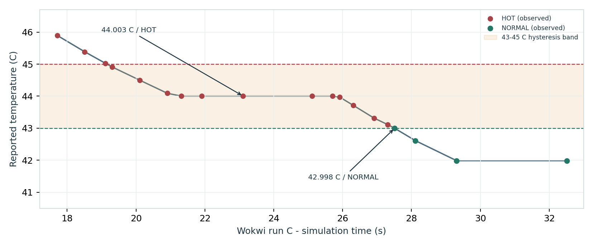

# ThermoBench — ESP32 Temperature Sensing & Validation

Engineering portfolio demonstrating embedded sensing, analog simulation, PCB design, hardware measurements, and temperature-alarm firmware validation.

## Key artifacts

- **[Complete engineering report (23-page PDF)](01_Report/ThermoBench_Engineering_Design_and_Validation_Report.pdf)** — design, figures, measurements, limitations, LTspice and verified Wokwi tests.
- **[Interview presentation guide](01_Report/ThermoBench_Interview_Study_Guide.pdf)** — short project explanation and speaking notes; the master report has the latest Wokwi test results.
- **[Editable KiCad files](02_KiCad_Source/)** — schematic (`.kicad_sch`), project (`.kicad_pro`), and routed PCB (`.kicad_pcb`).
- **[Embedded and Python source](04_Firmware_and_Python/)** — ESP32 sketch, Python dashboard, data processing and tests. Read its `BUILD_STEPS.md` first.
- **[Physical test recordings](05_Hardware_CSV/)** and **[derived measurements/plots](06_Analysis/)**.
- **[LTspice simulation](09_LTspice_Simulation/)** — original circuit netlists, logs, raw results, and Bode/temperature figures.
- **[Wokwi simulation](10_Wokwi_Simulation/)** — editable ESP32 `sketch.ino` + `diagram.json`, test cases, observed serial excerpts, and figures.

## Hardware and firmware summary

An external NTC thermistor forms a voltage divider with **R1 = 9.82 kΩ**; **R2 = 990 Ω** and **C1 = 100 nF** provide an analog filter before the ESP32 ADC at GPIO34. The KiCad board measures **50 × 35 mm** and includes test points and two mounting holes.

The separately labeled **Wokwi** model uses the simulator's three-pin NTC module with its **built-in** divider, rather than faithfully emulating the external KiCad R1/R2/C1 circuit. Use LTspice for analog response and Wokwi for virtual firmware behavior.

### Wokwi evidence (user-run simulator)

| NTC setting / condition | Reported temperature | ADC voltage | State |
|---|---:|---:|---|
| Baseline ~25°C | 24.989°C | 1650.40 mV | NORMAL |
| 35°C | 35.000°C | 1300.66 mV | NORMAL |
| 46°C | 45.987°C | 973.48 mV | HOT |
| Cooling, ~44°C | 44.003°C | 1027.47 mV | HOT |
| Cooling, below 43°C | 42.998°C | 1055.68 mV | NORMAL |

HOT activates at **45°C** and clears at **43°C** (2°C hysteresis). The recorded virtual over-range event reached **63.304°C** and set `OUT_OF_RANGE`; the current implementation clears the HOT latch during faults. See the report for observations and recommended changes. The Wokwi evidence CSV contains **selected transcribed log rows**, not a complete exported run.

## How to open

1. **KiCad 10:** Open `02_KiCad_Source/ThermoBench_Sensor_Adapter.kicad_pro`.
2. **LTspice:** Open the `.cir` netlists in `09_LTspice_Simulation/Original_Circuits_and_Results/` and run the simulation.
3. **Wokwi:** Start a new [ESP32 project](https://wokwi.com/projects/new/esp32); replace `sketch.ino` and `diagram.json` with the files from `10_Wokwi_Simulation/`, then run.
4. **Python:** Read `04_Firmware_and_Python/BUILD_STEPS.md` and `requirements.txt` before running `dashboard.py` or the tests.

## Verification boundary

- Breadboard sensor response, selected physical-data recordings and Wokwi alarm thresholds are documented; the physical prototype and simulator are **distinct test environments**.
- The populated PCB was **not manufactured or physically tested**. KiCad DRC checks are not proof of mechanical fit or manufacturability.
- The project does **not** establish calibrated absolute temperature accuracy. The LTspice 26°C comparison is model consistency, not calibrated validation.
- `07_Reference_Exports/Preliminary_Gerbers` is **NOT FOR MANUFACTURING**.
- `08_Synthetic_Demo_Only` contains clearly identified **synthetic** demonstrations, not hardware evidence.
- Work was developed with **AI assistance**, including portions of the documentation and supporting scripts. Source, recorded observations, and limitations are provided for review.

See [README_START_HERE.md](README_START_HERE.md) for the complete original package map, and [FIGURES_AND_SCHEMATICS_INDEX.md](FIGURES_AND_SCHEMATICS_INDEX.md) for figures.

## Publishing and license

This repository is published as a technical portfolio. No reuse license is granted by default; add a license if you intend to permit others to reuse the code/designs. Review screenshots, PDF metadata and local simulation logs for any details you do not want to share publicly.
