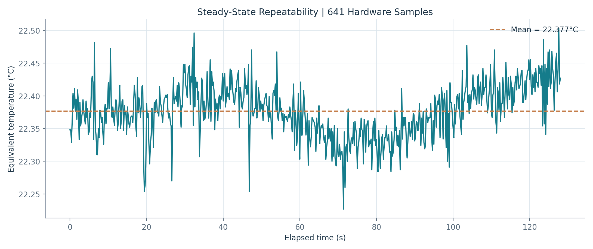

# ThermoBench | Hardware Measurements, Graphs & Evidence Guide

**Purpose:** Find the original records, understand each result, and independently reproduce the reported statistics. This guide describes **archived evidence**; it does not claim new experiments, calibrated temperature accuracy, or testing of the designed PCB.

> **Read this distinction first:** `HARDWARE` identifies rows recorded from the physical breadboard/ESP32 workflow. The `temp_c` values are **temperatures estimated by the firmware's thermistor model**, not independent reference-thermometer measurements. LTspice, Wokwi, and synthetic demonstrations are separate evidence types.

## 1. Find the evidence quickly

| Looking for | Open | Why it matters |
|---|---|---|
| Final engineering report | [23-page PDF](../01_Report/ThermoBench_Engineering_Design_and_Validation_Report.pdf) | Project design, analysis, and limitations |
| Original physical CSV files | [Hardware recordings](../05_Hardware_CSV/) | Four unmodified source datasets |
| Stored numerical results | [measurement_metrics.json](../06_Analysis/measurement_metrics.json) | Counts, means, SDs, extrema, and durations |
| Original analysis method | [Analysis_Methodology.md](../06_Analysis/Analysis_Methodology.md) | Definitions and data provenance |
| Independent read-only verification | [verify_hardware_csv.py](../tools/verify_hardware_csv.py) | Recomputes statistics from the CSVs and checks saved metrics |
| Stable-run graph | [steady_state_temperature.png](../06_Analysis/steady_state_temperature.png) | Variability of firmware-reported temperature during a stable capture |
| Dynamic-run graph | [thermal_response.png](../06_Analysis/thermal_response.png) | Time response during a changing-temperature capture |
| Voltage and temperature plot | [voltage_vs_temperature.png](../06_Analysis/voltage_vs_temperature.png) | Relationship between ADC voltage and calculated temperature |
| Additional hardware plots | [initial_warming.png](../06_Analysis/initial_warming.png) / [thermal_voltage.png](../06_Analysis/thermal_voltage.png) | Further views of the recorded responses |
| LTspice results | [simulation documentation](../09_LTspice_Simulation/README_LTspice.md) | Analog-model evidence, **not** physical readings |
| Wokwi results | [Wokwi documentation](../10_Wokwi_Simulation/README_WOKWI.md) | Virtual firmware observations, **not** the physical board |
| Synthetic demonstrations | [synthetic data notice](../08_Synthetic_Demo_Only/README_SYNTHETIC.md) | Demonstration data deliberately excluded from hardware analyses |

## 2. Original hardware datasets: independently checked

Four files under [`05_Hardware_CSV/`](../05_Hardware_CSV/) use the same columns: `source,ms,mv,temp_c,status`. The data below were independently recomputed from the **original rows** and agree with [`measurement_metrics.json`](../06_Analysis/measurement_metrics.json) to the stated precision.

| Recording (filename) | Rows | Span | Mean reported temp (°C) | Sample SD (°C) | Reported temp min–max (°C) | What the run shows |
|---|---:|---:|---:|---:|---:|---|
| [22:47:27 capture](../05_Hardware_CSV/hardware_20261019_224727_796590.csv) | 16 | 3.0 s | 29.1011 | 0.1479 | 28.880–29.308 | Very short changing capture; **not** strong steady-state evidence |
| [22:47:52 capture](../05_Hardware_CSV/hardware_20261019_224752_255773.csv) | 133 | 26.4 s | 29.5673 | 1.7816 | 26.220–31.766 | Changing-temperature behavior; SD includes the trend |
| [23:47:15 stable capture](../05_Hardware_CSV/hardware_20261019_234715_916346.csv) | 641 | 128.0 s | 22.3765 | 0.0412 | 22.227–22.503 | Best archived stability/repeatability example |
| [23:52:31 dynamic capture](../05_Hardware_CSV/hardware_20261019_235231_403927.csv) | 544 | 108.6 s | 26.5838 | 2.9849 | 22.423–30.829 | Rise and subsequent decline in the firmware temperature estimate |
| **Combined** | **1,334** | **Separate sessions** | — | — | — | Never treat the four runs as one continuous time series |

**Recorded cadence:** Adjacent `ms` timestamps differ by **200 ms** in each file (nominal **5 samples/s**). The timestamps are relative to the device clock and should be interpreted *within* each run, not joined across sessions. All 1,334 source rows are labeled `HARDWARE`; all status fields are `NORMAL`.

A short run or a moving-temperature run should not be evaluated as though its temperature was constant. The much larger SD in the dynamic captures is expected when the signal changes; it is **not by itself** an accuracy or sensor-quality failure.

## 3. Three graphs to understand first

### Figure 1 — Stable reported temperature



**Source:** 641-row stable capture. **Interpretation:** The reported temperature has a sample SD of **0.0412 °C** across **128.0 s**. This is evidence of low *short-term variation in the firmware-derived estimate under that run's conditions*. The preliminary repeatability target in the archived methodology is **SD ≤ 0.15 °C**. It is **not** proof that the estimate agrees with an external thermometer or that the sensor achieves ±0.0412 °C accuracy.

### Figure 2 — Dynamic thermal response


**Source:** 544-row changing-temperature capture. **Interpretation:** The initial 20-second window (inclusive endpoint as used in the archived metrics) has a mean reported temperature of **22.5134 °C**. The maximum reported value is **30.829 °C** at **57.2 s after the first row**; the final reported value is **24.661 °C** at **108.6 s**. This demonstrates recorded response to a change, not a calibrated time constant or controlled chamber test.

### Figure 3 — Temperature versus ADC voltage


**Source:** Original analysis figure under `06_Analysis/`. **Interpretation:** Inspect how the measured ADC voltage and firmware-calculated temperature move together. In the thermistor divider model, rising temperature reduces thermistor resistance and the sense voltage decreases. The plotted relationship is **not an independent temperature calibration** because the reported temperature is derived from the voltage measurement itself.

Additional plots: [initial warming](../06_Analysis/initial_warming.png) and [thermal voltage response](../06_Analysis/thermal_voltage.png). Each file should be interpreted using its corresponding source rows and the [methodology](../06_Analysis/Analysis_Methodology.md), rather than treating every image as an independent experiment.

## 4. How the statistics were calculated

For the numeric column `temp_c` in one recording containing `n` rows:

- **Mean:** `mean = sum(temp_c) / n`.
- **Sample standard deviation (SD):** `SD = sqrt(sum((temp_c - mean)^2) / (n - 1))` for `n > 1`. This uses **ddof = 1**, not population SD.
- **Time span:** `(last ms - first ms) / 1000`, in seconds.
- **Sample interval:** successive `ms` differences, in milliseconds.
- **Peak elapsed time:** `(ms at first maximum temp_c - first ms) / 1000`.
- **Initial 20-second window:** all timestamps at most **20,000 ms** after the first row, **including** a point exactly at 20,000 ms.

The archived graphs were described as generated from original rows without smoothing, resampling, interpolation, or added synthetic data. The repository does **not** include the exact flashed firmware binary for the recordings, so these cannot independently establish the precise temperature-conversion configuration that was active during capture.

## 5. Reproduce the numbers yourself (Windows PowerShell)

From the **repository root** (`ThermoBench-ESP32-Sensor-Validation`):

```powershell
py .\tools\verify_hardware_csv.py
```

This script uses only the Python standard library. It reads the **four original CSV files** and `06_Analysis/measurement_metrics.json`, recalculates their summary statistics, and reports a PASS/FAIL for consistency. **It never overwrites recordings, changes graphs, or fabricates test results.**

Expected overall result for the current archived data: **4 datasets verified; 1,334 rows; matching recorded summary statistics**. If it fails, inspect the specific discrepancy and the file content before publishing a changed result.

**Optional existing analysis workflow:** The [`station.py`](../04_Firmware_and_Python/station.py) script can analyze a single compatible CSV and output a JSON report and graph; see the [firmware and Python guide](firmware-python-guide.md) for dependencies. Its steady-state checks assume fixed, settled input. Don't apply a stable-run repeatability conclusion to a deliberately changing-temperature capture.

## 6. Do not mix the four evidence categories

| Category | Where | What it supports | What it does **not** support |
|---|---|---|---|
| Physical breadboard CSV recordings | [`05_Hardware_CSV/`](../05_Hardware_CSV/) | Recorded voltage, timestamps, firmware-derived temperature and NORMAL state | Calibrated temperature accuracy, injected faults, PCB performance |
| LTspice models | [`09_LTspice_Simulation/`](../09_LTspice_Simulation/) | Predicted circuit transfer and AC filter response, including the modeled 9.82 kΩ divider | Physical PCB fabrication, measured frequency response |
| Wokwi simulation | [`10_Wokwi_Simulation/`](../10_Wokwi_Simulation/) | Selected virtual firmware setpoints and HOT/NORMAL hysteresis behavior | Hardware alarm verification, or recreation of the exact external KiCad R1/R2/C1 network |
| Synthetic/demo output | [`08_Synthetic_Demo_Only/`](../08_Synthetic_Demo_Only/) | Illustrative software analytics and SPC examples | Physical sensor measurements or actual capability metrics |

**Wokwi-specific caution:** The evidence file contains *selected excerpts across three separately timed simulator sessions*, not a complete continuous log. Its virtual NTC module includes its own internal divider. The archived Wokwi testing documented a HOT transition at about 45 °C and a return to NORMAL near 43 °C under the simulated firmware; these are **virtual observations**, not tests on the real breadboard. See the [test results summary](../10_Wokwi_Simulation/Evidence/Wokwi_Test_Results_Summary.json).

## 7. Verification status and limitations

| Claim | Status |
|---|---|
| 1,334 rows in four hardware-labeled CSV recordings | **Verified by recomputation** |
| All sample intervals 200 ms within each file | **Verified by recomputation** |
| Stable capture sample SD 0.0412 °C | **Verified as a statistic of firmware estimates** |
| Dynamic capture peak 30.829 °C at 57.2 s | **Verified in recorded data** |
| Hardware fault inputs or HOT transitions occurred in the four CSVs | **Not demonstrated** — all statuses NORMAL |
| Independently calibrated absolute temperature accuracy | **Not established** — no synchronized thermometer reference |
| Exact firmware image flashed during original captures | **Not preserved in the archive** |
| PCB fabrication and board-level validation | **Not completed** |
| Earlier handheld-DMM readings near 1.58 V | **Context only** — not synchronized/reference-calibrated rows in the CSVs |

**Next physical tests to improve the project:** record an identified firmware version, use a reference thermometer and synchronized DMM/ADC observations at several steady temperatures, document supply voltage/resistor tolerances, capture repeat trials, and evaluate fault-state handling with safe controlled input tests. These are **proposed tests**, not completed evidence.

## 8. Why this matters in an interview

You can credibly explain: *“I recorded 1,334 ESP32 breadboard samples in four separate runs, independently checked the logging cadence and summary statistics, and documented a short-term repeatability result of 0.0412 °C SD under one stable capture. That number is measurement variation of the model-derived estimate, not absolute temperature accuracy. My circuit and PCB are documented separately, and I have not claimed PCB fabrication or calibrated temperature performance.”*

For the overall project, return to the [main README](../README.md), [engineering calculations](calculations.md), [hardware/PCB guide](hardware-pcb-guide.md), and [firmware/Python guide](firmware-python-guide.md).
